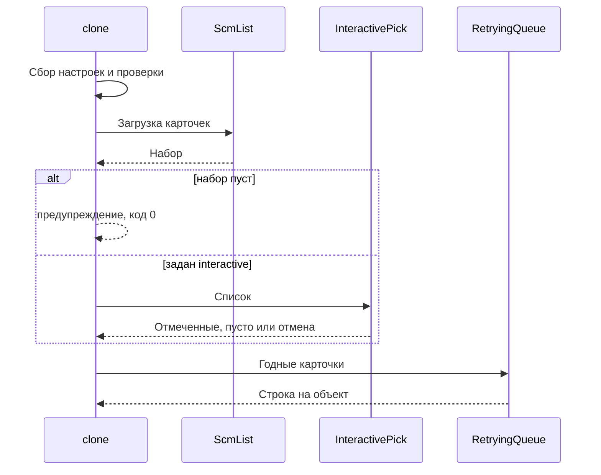

# clone

Команда `clone` по [SCM-отбору](../../platform/scm-repository-selection.md) получает набор репозиториев на
[SCM-платформе](../../../../glossary/terms/scm-platform.md) и клонирует его в каталог `--workspace`. Загрузка
карточек — процесс [«Загрузка из SCM и обогащение карточек
репозиториев»](../../scm/index.md). Локальное получение копий выполняет `git clone`
установленного на машине `git`.

## Контракт

### Синтаксис

```text
githerd [глобальные опции] clone [опции SCM-отбора] [опции clone]
```

Глобальные флаги — [глобальные параметры CLI](../index.md). После сборки
настроек для `clone` нужны `upstream` и `token`; `host` — по
[подключению к SCM](../index.md#подключение-к-scm).

`--workspace` / `-w` задаёт корень, в который кладутся рабочие копии.
Приведение к абсолютному пути — [правила workspace](../index.md#workspace). Команда
этот флаг не игнорирует.

Критерии отбора (`--qp`, `--qn`, `--qt`, `--qa`, `--scm-search`, `--scope`
и параметры расширения выбранной платформы) — только
[SCM-отбор](../../platform/scm-repository-selection.md). Таблицу критериев здесь не повторяют.

### Опции команды

| Имя | Алиас | Тип | По умолчанию | Назначение |
| --- | ----- | --- | ------------ | ---------- |
| `--existing` | `-E` | `skip` \| `drop` | `skip` | Что делать с уже существующим непустым каталогом назначения — [существующий каталог](#существующий-каталог). |
| `--preserve-path` | — | логический | выключен | Не отрезать общий хвост пути — [совмещение пути](#совмещение-пути). Вместе с `--path-attribute` не задаётся. |
| `--interactive` | `-i` | логический | выключен | Дать отметить репозитории галочками после загрузки карточек — [интерактивный отбор](#интерактивный-отбор). |
| `--all` | `-A` | логический | выключен | Не спрашивать [порог подтверждения][mass-confirm], когда карточек больше 10. |
| `--git-opts` | — | повтор строки | не задан | Аргументы `git clone`, по одному на повтор — [передача параметров git](#передача-параметров-git). |
| `--protocol` | — | `ssh` \| `https` | `ssh` | По какому протоколу собирать адрес для `git clone` — [адрес клонирования](#адрес-клонирования). |
| `--path-attribute` | — | строка | не задан | Имя пользовательского атрибута. Каталог копии берётся из его значения; пустое значение — сам `--workspace`. Вместе с `--preserve-path` не задаётся. [Каталог по атрибуту][attr-dir]. |

В профиле YAML те же ключи без `--`: `existing`, `preserve-path`,
`interactive`, `all`, `git-opts`, `protocol`, `path-attribute`
([профили](../../platform/profiles.md)). Логические флаги — по
[синтаксису опций](../index.md#синтаксис-опций).

Канон `--existing` — нижний регистр: `skip` или `drop`. Канон `--protocol` —
`ssh` или `https`. Другое значение — ошибка настроек, код `1`, до запросов
к SCM.

## Поток выполнения

1. **Собирает настройки.** Для каждого параметра — порядок

   [выбора значения](../../platform/profiles.md#порядок-выбора-значения). Повтор `--git-opts`: если флаг задан
    в командной строке, берётся только она, список из профиля не
    подмешивается — то же правило происхождения, что у повторяемых критериев
    ([резолв с профилем](../../platform/scm-repository-selection.md#резолв-с-профилем)).
2. **Проверяет настройки до запросов к SCM.** Обязательные параметры

   подключения; критерии и конфликты — по [hub](../../platform/scm-repository-selection.md), включая ошибку
    «критерий не задан». Исключение команды `report` для пустого набора
    критериев на `clone` не распространяется. Проверяет `--existing` и
    [запрещённые аргументы git](#запрещённые-аргументы). Если задан
    `--path-attribute`, а `upstream` не github, имя атрибута пустое или
    задан ещё и `--preserve-path`, завершает с кодом `1`. Если задан
    `--interactive`, а стандартный ввод
    или вывод — не терминал, завершает с кодом `1`. `--all` вместе с
    `--interactive` — код `1` по [порогу подтверждения][mass-confirm].
3. **Загружает карточки с SCM** целиком по [оркестрации][scm-index],

   включая прогресс страниц и обогащения. Повторы этой фазы здесь не
    пересказываются: их задают [очередь повторов](../../platform/retrying-queue.md) и
    `--retries-number` / `--on-error`.
4. **Пустой набор.** Отбор прошёл без ошибки, карточек 0: предупреждение

   в журнал (`level=warn`) и то же текстом на экран; код `0`. Очередь
    клонирования не запускается, интерактивный список не открывается,
    каталог `--workspace` из-за этого шага не создаётся.
5. **Интерактивный отбор** — только если задан `--interactive` и набор

   не пуст. См. [ниже](#интерактивный-отбор). Отмена и подтверждение без
   галочек — код `0`, диск не меняется. Это не ошибка.
6. **Порог.** Число карточек, которые пойдут дальше, сверяет с
   [порогом подтверждения][mass-confirm]. Отказ — код `0`, каталоги не
   создаются. Нет терминала при превышении порога без `--all` — код `1`.
7. **Готовит корень.** Если `--workspace` ещё не каталог, создаёт его.

   Если по этому пути уже лежит файл — код `1`, очередь не запускается.
8. **Делит карточки.** Если задан `--path-attribute`, для каждой

   карточки в порядке списка сначала читает значение —
   [каталог по атрибуту][attr-dir]. Чтение — отдельный объект
   [очереди повторов][queue]. Прогресс-бара у этого чтения нет. Ошибка
   чтения после повторов — строка `✖`, в очередь клонирования карточка
   не ставится. При `--on-error abort` на первой такой ошибке команда
   останавливается. При `continue` обход продолжается.
   Затем для каждой карточки без ошибки чтения вычисляет каталог
   назначения. Задан `--path-attribute` — по [атрибуту][attr-dir].
   Иначе — по [совмещению пути][merge-path]. В совмещении пустой
   остаток — строка `✖` до очереди. В атрибуте то же для сегмента
   `..`, нестрокового значения и файла по каталогу назначения. Повтор
   путь не исправит. `abort` и `continue` — как для ошибки чтения.
   Годные карточки становятся объектами очереди клонирования.
9. **Клонирует очередь.** Прогон последовательный. На время `git clone`
   видна [строка хода][git-step], шаг `clone`. Метка — полное имя из
   [строки результата](#строки-результата). Обработчик одного объекта —
   [ниже](#обработчик-объекта). На каждое конечное состояние объекта —
   одна строка результата.



## Интерактивный отбор

Команда передаёт в [интерактивный отбор списка](../../platform/interactive-selection.md) строки в порядке
набора. Видимый текст строки — [полное имя](../report/index.md#вывод-на-консоль) репозитория.
Адрес гиперссылки — поле `url` [карточки](../../platform/scm-repository-card.md).

Дальше команда читает только исход отбора:

- отмена (ESC) — код `0`, сообщения об ошибке нет; каталоги не создаются
  и не удаляются;
- подтверждение без отмеченных строк — код `0`, то же;
- иначе в шаги 6–9 идут только отмеченные карточки, в прежнем порядке.

## Совмещение пути

Для совмещения берут [полное имя](../report/index.md#вывод-на-консоль) из вывода `report`,
не поле `path` [карточки](../../platform/scm-repository-card.md).

Абсолютный `--workspace` делят на сегменты по разделителю каталогов
операционной системы. Полное имя делят по `/`. Пустые сегменты отбрасывают.
Сегменты сравнивают как строки Юникода точно, с учётом регистра. Берётся
самый длинный хвост `--workspace`, который совпал с головой полного имени.
Каталог назначения — абсолютный `--workspace` и несовпавший хвост полного
имени, склеенные разделителем каталогов операционной системы.

Пример. `--workspace` после приведения к абсолютному пути заканчивается
сегментами `buzz`, `fizz`. Полное имя — `buzz/fizz/hrenator-figator-crud`.
Общий хвост `buzz/fizz` не повторяется. Назначение —
`…/buzz/fizz/hrenator-figator-crud`.

Если задан `--preserve-path`, совмещение не выполняется: к абсолютному
`--workspace` целиком приписывается полное имя. В том же примере общий
`buzz/fizz` повторяется. Вместе с `--path-attribute` флаг не задаётся —
проверка на шаге 2.

Недостающие каталоги-родители назначения создаются перед `git clone`.
Сам каталог назначения создаёт `git`, кроме уже существующего пустого
каталога: в него `git clone` пишет напрямую.

Пустой остаток (всё полное имя совпало с хвостом `--workspace`) в очередь
не ставится.

## Каталог по атрибуту

Раздел действует, только если задан `--path-attribute`. Вместе с
`--preserve-path` флаг не задаётся — проверка на шаге 2. Чтение
значения — [чтение значения свойства][github-read]. Из чего собрана
строка — [путь в атрибуте][publish-attr] команды `publish`. Здесь
строка только превращается в каталог.

Значения нет, в том числе `null`, — каталог назначения равен
абсолютному `--workspace`.

Значение не строка — строка `✖` до очереди клонирования. Повтор это
не исправит.

Строковое значение делится по `\` и по `/`. Пустые сегменты и сегмент
`.` отбрасываются. Сегмент `..` — строка `✖` до очереди клонирования.
Повтор это не исправит.

Сегментов не осталось — назначение равно абсолютному `--workspace`.
Так обрабатываются пустая строка и строка из одной точки `.`. Это не
пустой остаток совмещения: карточка в очередь ставится.

Оставшиеся сегменты — путь копии целиком. Поле `name`
[карточки][card] к пути не добавляется. Каталог назначения —
абсолютный `--workspace` и эти сегменты.

Дальше это обычный каталог назначения: родители, пустой каталог и
`git clone` — [совмещение пути][merge-path] и
[существующий каталог][existing-dir]. Несколько карточек с одним
назначением делят каталог; что делать с уже существующим — там же.

Пример. `--workspace` — `F:\work`, значение атрибута — `domain/billing/api`.
Назначение — `F:\work\domain\billing\api`. Значения нет или оно `.` —
назначение `F:\work`.

## Существующий каталог

Политика `--existing` смотрит только на каталог назначения в том виде,
в каком он был **до первой попытки** этого объекта.

| Состояние до первой попытки | `skip` | `drop` |
| --------------------------- | ------ | ------ |
| Пути нет | Клонировать | Клонировать |
| Пустой каталог | Клонировать в него | Клонировать в него |
| Непустой каталог | Не вызывать `git`. Это не ошибка | Удалить дерево каталога, затем клонировать |
| Файл | В очередь не ставится | В очередь не ставится |

`skip` непустого каталога — конечное состояние «пропущен», строка `➡️`.

Не удалось удалить дерево при `drop` — ошибка обработчика. Её повторяет
очередь. Пока удаление не удалось, непустой каталог, бывший до первой
попытки, по-прежнему подпадает под `drop`.

## Адрес клонирования

Источник — поле `url` карточки, адрес страницы репозитория в интерфейсе SCM.
По умолчанию клонирование идёт по `ssh`.

| `--protocol` | Адрес для `git clone` |
| ------------ | --------------------- |
| `https` | Строка `url` без изменений. |
| `ssh`, порта в `url` нет | `git@хост:путь.git`. Путь — из `url` без ведущего `/`. Если путь уже кончается на `.git`, суффикс не повторяется. |
| `ssh`, в `url` есть порт | `ssh://git@хост:порт/путь.git`. Правило суффикса `.git` то же. |

Пример. `url` равен `https://gitlab.example/g/api`, протокол по умолчанию.
Адрес клонирования — `git@gitlab.example:g/api.git`.

Неразбираемый `url` — строка `✖` для этого объекта до запуска `git`. Повтор
путь не исправит: при `abort` остальные не обрабатываются, при `continue`
обход продолжается. Это то же правило, что у пустого остатка после
[совмещения пути](#совмещение-пути).

## Обработчик объекта

1. Применить [политику существующего каталога](#существующий-каталог), если

   это ещё не сделано успешным удалением на прошлой попытке.
2. Запустить через **GitCliRunner** процесс:
   ```text
    git clone <аргументы --git-opts> -- <адрес клонирования> <каталог назначения>
   ```

   Адрес собирается из поля `url`
   [карточки](../../platform/scm-repository-card.md)
   по [правилам выше](#адрес-клонирования). `--token` в аргументы и в
   окружение процесса не передаётся. Непустой `--git-https-token` при
   схеме `https` подставляется в userinfo адреса по
   [правилу флага](../index.md#--git-https-token). Иначе `git` пользуется
   учётными данными, уже настроенными на машине.
3. Успех процесса — успех объекта.
4. Любая ошибка процесса — ошибка обработчика. Повтор и `--on-error` —

   [очередь повторов](../../platform/retrying-queue.md). Перед следующей попыткой обработчик удаляет
    каталог, который создал или заполнил неуспешный `git clone` этой серии,
    чтобы повтор не упёрся в непустой каталог и не стал `skip`.
5. Вывод процесса на консоль не попадает. Текст stdout и stderr пишется в

   [журнал прогона](../../platform/logging.md). В строке `✖` — первая непустая строка этого
    текста после обрезки пробелов. Если такой строки нет — фраза
    «клонирование не удалось».

Один и тот же список `--git-opts` передаётся в `git clone` каждого объекта.

## Передача параметров git

Каждое значение `--git-opts` — один аргумент процесса, в порядке повторов
флага или элементов последовательности в профиле. Значение записывают через
`=`, потому что оно само начинается с `-`:

```text
githerd clone --git-opts=--depth=1 --git-opts=--branch=develop
```

В профиле, если спека допускает повтор, значение — скаляр или
последовательность ([профили](../../platform/profiles.md#структура-yaml)):

```yaml
clone:
  git-opts:
    - --depth=1
    - --branch=develop
```

### Запрещённые аргументы

Проверка один раз после резолва, до запросов к SCM. Нарушение — код `1`.

Запрещён токен, если выполняется любое из условий:

- токен не начинается с `-` или токен равен `--` (это был бы адрес
репозитория или каталог);
- токен равен `--separate-git-dir` или начинается с `--separate-git-dir=`;
- токен задаёт конфигурацию `git` ключом из запрещённого списка ниже.

Конфигурация — отдельный токен `-c` или `--config` и следующий токен
`ключ=значение`, либо один токен `--config=ключ=значение` или
`-c=ключ=значение`. Ключ — часть до первого `=`. Нет значения у `-c` /
`--config` — тоже код `1`.

Ключ сравнивают без учёта регистра. Запрещены:

- ключ с префиксом `credential.`;
- ключ `http.extraheader`;
- ключ вида `url.<что угодно>.insteadof`;
- ключ вида `remote.<что угодно>.url`.

Остальные флаги `git clone` продукт не перечисляет: их принимает или
отвергает `git` из `PATH` ([ADR-26101702](../../../../ADR/ADR-26101702-host-git-from-path.md)).

## Строки результата

Прогресс-бар есть только у загрузки карточек ([оркестрация](../../scm/index.md)).

На каждый объект в конечном состоянии — одна строка UTF-8 на стандартный
вывод. В строке [полное имя](../report/index.md#вывод-на-консоль), не локальный путь:

| Состояние | Строка |
| --------- | ------ |
| Репозиторий склонирован | `✔` пробел полное имя |
| Клонировать не удалось | `✖` пробел полное имя, двоеточие, пробел, краткая причина |
| `skip` непустого каталога | `➡️` пробел полное имя |

Пока у объекта есть следующая попытка, строку не пишут.

## Коды завершения

Сводка для `clone`. Общие правила — [коды выхода CLI](../index.md#коды-выхода).

| Код | Когда |
| --- | ----- |
| `0` | Каждый взятый в работу объект склонирован или пропущен; [пустой набор](#поток-выполнения); отмена интерактивного отбора; подтверждение без галочек. |
| `1` | Ошибка настроек или отбора; запрещённые аргументы `git`; нет терминала при `--interactive`; нет терминала при [пороге][mass-confirm] без `--all`; `--all` вместе с `--interactive`; файл вместо `--workspace`; `abort` на сбое; `continue`, но был хотя бы один `✖`. |
| `2` | Неверный вызов CLI (Cobra), если применимо. |

## Инварианты

- Одна карточка отобранного набора — не больше одного каталога назначения.
- Аргументы `git clone`, пришедшие через `--git-opts`, одинаковы для каждого
объекта прогона.
- Секрет доступа к API SCM в процесс `git` не подставляется.
- Критерии отбора читаются только из [SCM-отбора](../../platform/scm-repository-selection.md).
- Если задан `--path-attribute`, каталог назначения берётся из
  [каталога по атрибуту][attr-dir]. Иначе — из
  [совмещения пути][merge-path].

## Трассировка вверх

- [Массовое клонирование из SCM](../../../product-intent/capability/scm/mass-clone.md)
- [Единый отбор](../../../product-intent/capability/platform/repository-selection.md)
- [Обратная связь в терминале](../../../product-intent/capability/platform/terminal-feedback.md)
- [Отказоустойчивое выполнение сетевых шагов](../../../product-intent/capability/platform/resilient-network-execution.md)
- [ADR-26101702](../../../../ADR/ADR-26101702-host-git-from-path.md) — `git` с машины пользователя
- [ADR-26110801](../../../../ADR/ADR-26110801-go-package-layout.md) — компонент GitCliRunner

## Не описывать здесь

- Листинг, обогащение и поля карточки — [оркестрация](../../scm/index.md) и
[карточка](../../platform/scm-repository-card.md).
- Повтор объекта и коды `--on-error` очереди — [очередь повторов](../../platform/retrying-queue.md).
- Рисование галочек и фильтра — [интерактивный отбор списка](../../platform/interactive-selection.md).
- Правило порога, вопрос и отказ — [порог подтверждения][mass-confirm].
- Состав строки `--path-attribute` — [путь в атрибуте][publish-attr].
- HTTP чтения свойства — [чтение значения свойства][github-read].
- Формат строки хода долгого шага `git` — [ход шага][git-step].
- Код в `application/`.

<!-- LINKS -->
[mass-confirm]: ../../platform/mass-confirm.md
[attr-dir]: #каталог-по-атрибуту
[merge-path]: #совмещение-пути
[existing-dir]: #существующий-каталог
[queue]: ../../platform/retrying-queue.md
[github-read]: ../../scm/github/repository-management.md#чтение-значения-свойства
[publish-attr]: ../publish/index.md#путь-в-атрибуте
[card]: ../../platform/scm-repository-card.md
[scm-index]: ../../scm/index.md
[git-step]: ../../platform/git-step-status.md
