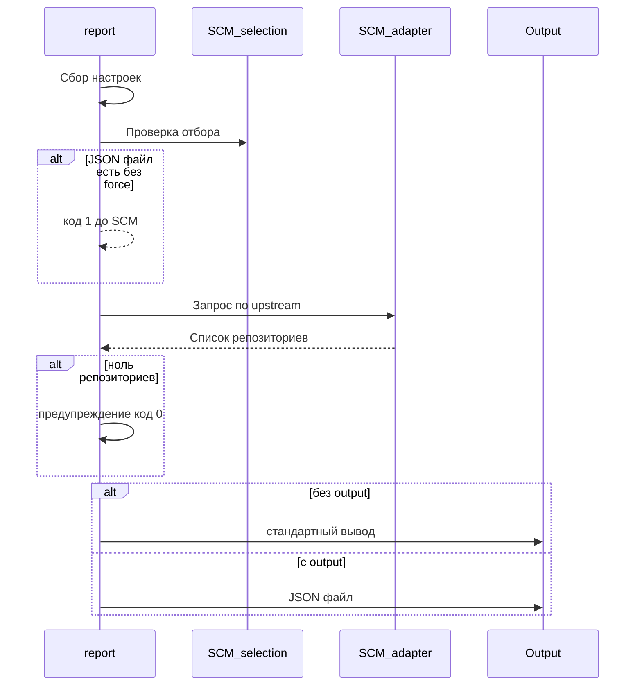

# report

Команда `report` по [SCM-отбору](../../platform/scm-repository-selection.md) получает список
репозиториев на [SCM-платформе](../../../../glossary/terms/scm-platform.md) и выводит его на экран или в
JSON-файл. Состояние на SCM **не** меняется. Режим «счётчик» из
[capability отчётов](../../../product-intent/capability/scm/scm-repository-reports.md) здесь **не** описан.

## Контракт

### Синтаксис

```text
githerd [глобальные опции] report [опции SCM-отбора] [опции report]
```

Глобальные флаги — [глобальные параметры CLI](../index.md). Для `report` нужны
`upstream`, `token` и `host` после сборки настроек ([подключение к SCM](../index.md#подключение-к-scm)).
`--workspace` **игнорируется**.

Критерии отбора (`--qp`, `--qn`, `--qt`, `--qa`, `--scm-search`, `--scope`; для GitLab
ещё `--include-inactive` — [extension](../../scm/gitlab/repository-selection-extensions.md)) —
полный контракт в [scm-repository-selection.md](../../platform/scm-repository-selection.md), таблицы
здесь **не** повторяют.

### Опции команды

| Имя | Алиас | Тип | По умолчанию | Назначение |
| --- | ----- | --- | ------------ | ---------- |
| `--output` | `-o` | строка, необязательна | не задан | Куда писать результат — [режим вывода](#режим-вывода). |
| `--force` | — | логический | `false` | Перезаписать JSON-файл, если он уже есть — [режим вывода](#force). |

В профиле YAML те же ключи без `--`: `output`, `force` ([profiles.md](../../platform/profiles.md)).

## Поток выполнения

1. **Собирает настройки.**
   - Для каждого параметра команда выбирает итоговое значение в порядке: аргументы
    командной строки, блок текущей команды в профиле, родительские блоки, `root`,
    встроенное значение по умолчанию ([profiles.md](../../platform/profiles.md#порядок-выбора-значения)).
   - Собирает **глобальные** флаги (`upstream`, `host`, `token`, повторы, `--on-error` и
   остальные из [глобальных параметров CLI](../index.md)); для `report` после этого
   шага должны быть заданы `upstream` и `token`, а `host` — явно или по правилам
   пары `upstream` → хост по умолчанию.
   - Собирает **критерии SCM-отбора** (`--qp`, `--qn`, `--qt`, `--qa`, `--scm-search`,
   `--scope`, extension-параметры по `upstream` и одноимённые ключи профиля). Если
   параметр передан в argv, берёт только argv для этого ключа; иначе — значение из
   профиля или встроенный default (`scope` по умолчанию `affiliated`, остальные
   критерии — «не задан»).
   - Собирает **опции** `report`: `--output` / `-o`, `--force` (ключи `output`, `force` в
   профиле).
2. **Проверяет критерии отбора.**
   - Применяет правила из [scm-repository-selection.md](../../platform/scm-repository-selection.md)
     до любых запросов к SCM, кроме случая «нет ни одного критерия» — для `report` он
     описан отдельным пунктом ниже.
   - Запрещает одновременное использование `--scm-search` и любого из `--qp`, `--qn`,
     `--qt`, `--qa` после сборки настроек; при конфликте завершает с ошибкой, код `1`.
   - Проверяет синтаксис значений `--qt` и `--qa`; при неверном формате завершает с
     ошибкой, код `1`.
   - Если не задан **ни один** критерий (`--qp`, `--qn`, `--qt`, `--qa`, `--scm-search`;
     один только `--scope` (в т.ч. default `affiliated`) и модификаторы вроде
     `--include-inactive` критерием **не** считаются):
     - выводит **предупреждение**, что без критериев отбора перечисление репозиториев
       может занять много времени и создать высокую нагрузку на SCM API;
     - **интерактивно** запрашивает подтверждение ([обратная связь в
       терминале](../../../product-intent/capability/platform/terminal-feedback.md), pterm):
       пользователь должен явно подтвердить, что понимает последствия и просит
       продолжить;
     - при отказе завершает команду **до** запросов к SCM, код выхода `0`;
     - если интерактивный ввод недоступен (нет TTY), завершает с ошибкой, код `1`, с
       требованием задать критерии отбора или запустить команду в интерактивной сессии.
3. **Определяет способ вывода.**
   - По итоговому `--output` / `-o` после шага 1 выбирает канал; варианты — в
    [режиме вывода](#режим-вывода).
   - Если флага `--output` **нет** — готовит вывод на **стандартный вывод** (шаг 6,
   [вывод на консоль](#вывод-на-консоль)).
   - Если флаг **есть** без пути — готовит запись в JSON-файл с именем по умолчанию
   `githerd-report-${fs-timestamp}.json` в текущем каталоге ([имя файла по
   умолчанию](#имя-файла-по-умолчанию)).
   - Если флаг **есть** с непустым путём — готовит запись JSON по этому пути (относительный
   путь от текущего каталога, затем приведение к абсолютному — как в
   [profiles.md](../../platform/profiles.md#пути)).
   - Для JSON до запросов к SCM: если целевой файл **уже существует** и `--force` не
   задан — завершает с ошибкой, код `1` ([`--force`](#force)).
4. **Получает набор репозиториев с SCM.**
   - По значению `--upstream` (`github` или `gitlab`) вызывает адаптер выбранной
    платформы. В него передает критерии отбора после шагов 1–2 и параметры
    подключения (`host`, `token`).
   - Адаптер выполняет отбор по контракту [scm-repository-selection.md](../../platform/scm-repository-selection.md):
   перечисляет репозитории в допустимом контексте (с учётом `--scope`, extension и
   `--scm-search`), при необходимости дозагружает метаданные для `--qt` и `--qa`,
   отфильтровывает результат по `--qp`, `--qn`, `--qt` и `--qa`. Подробности шагов —
   в разделе [SCM-отбор](#scm-отбор).
   - Какие HTTP-запросы уходят в GitHub и GitLab, описано в
   [github/repository-enumeration.md](../../scm/github/repository-enumeration.md) и
   [gitlab/repository-enumeration.md](../../scm/gitlab/repository-enumeration.md).
   - При ошибке обращения к API команда повторяет запрос столько раз, сколько задано
   глобальным `--retries-number`; когда повторы закончились, срабатывает глобальный
   `--on-error` ([глобальные параметры CLI](../index.md#повторы-и---on-error)). Общие
   ожидания к массовым сетевым шагам — [отказоустойчивое выполнение по
   сети](../../../product-intent/capability/platform/resilient-network-execution.md).
5. **Обрабатывает пустой результат** — если после отбора репозиториев 0, см.

   [пустой отбор](#пустой-отбор).
6. **Выводит результат** — по решению шага 3 пишет отчёт на [стандартный

   вывод](#вывод-на-консоль) или в [JSON-файл](#вывод-в-json).



## SCM-отбор

Команда передаёт в адаптер все параметры отбора после шагов 1–2. Пайплайн
(перечисление, дозагрузка метаданных, локальная фильтрация) — в
[scm-repository-selection.md](../../platform/scm-repository-selection.md).

| `upstream` | Extension (CLI) | Запросы к API (enumeration) |
| ---------- | --------------- | --------------------------- |
| `github`   | [github/repository-selection-extensions.md](../../scm/github/repository-selection-extensions.md) | [github/repository-enumeration.md](../../scm/github/repository-enumeration.md) |
| `gitlab`   | [gitlab/repository-selection-extensions.md](../../scm/gitlab/repository-selection-extensions.md) | [gitlab/repository-enumeration.md](../../scm/gitlab/repository-enumeration.md) |

## Режим вывода

После сборки настроек флаг `--output` / `-o` задаёт, куда попадёт отчёт:

| Состояние `--output` | Куда пишем |
| -------------------- | ---------- |
| Флага **нет** | На **стандартный вывод** (консоль) — [вывод на консоль](#вывод-на-консоль). |
| Флаг **есть**, значение **пустое** (`--output`, `-o`, `--output=`) | В JSON-файл с именем по умолчанию — [имя по умолчанию](#имя-файла-по-умолчанию). |
| Флаг **есть**, значение **непустое** | В JSON по указанному пути — [вывод в JSON](#вывод-в-json). |

Разбор аргументов — [синтаксис опций](../index.md#синтаксис-опций). Путь со спецсимволами удобнее
передавать как `--output=путь` или в кавычках.

### Имя файла по умолчанию

Если JSON нужен, но путь в `--output` не указан, файл создаётся в **текущем каталоге**
на момент старта команды:

```text
githerd-report-${fs-timestamp}.json
```

`${fs-timestamp}` — формат **fs-timestamp** из [ADR-26101704](../../../../ADR/ADR-26101704-timestamp-formats.md). Если имя
уже занято в ту же миллисекунду — суффиксы `-2`, `-3`, … перед `.json` (там же).

Путь из `--output` приводят к абсолютному так же, как `workspace` в
[profiles.md][profiles.md#пути].

### `--force` {#force}

Только для записи JSON. Файл уже есть, а `--force` не задан — ошибка, код `1`, **до**
запросов к SCM. Без `--output` флаг **не** используется.

## Вывод на консоль

Когда `--output` после сборки настроек **не** задан:

- на стандартный вывод — по одной строке UTF-8 на репозиторий;
- в строке: **полное имя** (путь и имя на платформе одной строкой) и **ссылка** на репозиторий;
- между полями — символ табуляции;
- строки сортируют по полному имени (байты UTF-8);
- идентификатор SCM отдельной колонкой **не** выводят.

Сообщения pterm (прогресс и т.п.) не заменяют этот вывод —
[обратная связь в терминале](../../../product-intent/capability/platform/terminal-feedback.md).

## Вывод в JSON

Когда `--output` / `-o` **задан**:

- один файл UTF-8;
- внутри — один JSON-массив объектов репозиториев **после** отбора;
- каждый объект — нормализованная карточка от адаптера; в P0 в объекте достаточно
данных для полного имени и ссылки (имена полей в этой спеке не фиксируют);
- красивое форматирование не обязательно; построчный NDJSON **не** используют.

## Пустой отбор

Отбор прошёл без ошибки, репозиториев **0**:

- код выхода `0`;
- предупреждение в журнал (`level=warn`) и то же текстом на экран (pterm);
- консоль — пустой стандартный вывод;
- JSON — файл с `[]`.

## Коды завершения

Сводка для `report`; общие правила — [коды выхода CLI](../index.md#коды-выхода).

| Код | Когда                                                                                                                                                                                                                               |
| --- | ----------------------------------------------------------------------------------------------------------------------------------------------------------------------------------------------------------------------------------- |
| `0` | Успех; [пустой отбор](#пустой-отбор) с предупреждением; отказ от продолжения без критериев отбора на шаге 2. |
| `1` | Ошибка отбора или настроек ([scm-repository-selection.md](../../platform/scm-repository-selection.md)); запуск без критериев без TTY; нет обязательных SCM-параметров; JSON-файл есть без `--force`; не удалось записать файл; сбой SCM по правилам `--on-error`. |
| `2` | Неверный вызов CLI (Cobra), если применимо.                                                                                                                                                                                         |

Неверное значение логического `--force` — [синтаксис опций](../index.md#синтаксис-опций).

## Инварианты

- SCM только читается, репозитории **не** меняются.
- Критерии отбора — только [scm-repository-selection.md](../../platform/scm-repository-selection.md).
- Проверка существующего JSON-файла — **до** запросов к SCM.
- Режим «счётчик» этой командой **не** покрывается.

## Трассировка вверх

- [Отчёт о репозиториях в SCM](../../../product-intent/capability/scm/scm-repository-reports.md)
- [Единый отбор](../../../product-intent/capability/platform/repository-selection.md)
- [SCM-отбор (платформа)](../../platform/scm-repository-selection.md)
- [ADR-26101704](../../../../ADR/ADR-26101704-timestamp-formats.md) — метка времени в имени файла по умолчанию

## Не описывать здесь

- REST и поля API — [enumeration](../../scm/github/repository-enumeration.md) по upstream.
- Полную схему карточки репозитория.
- Код в `application/`.
