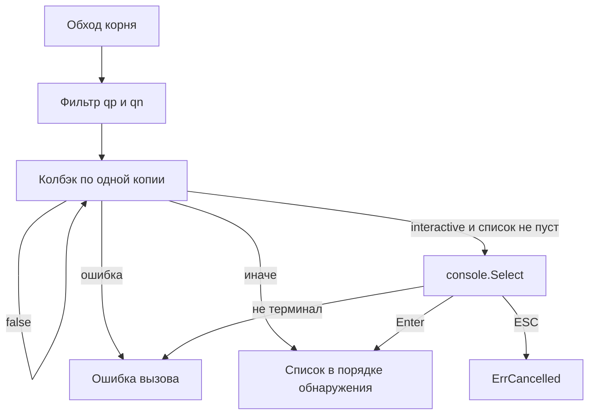

# Поиск рабочих копий

Контракт компонента **GitWorkingCopiesResolver**: найти рабочие копии в корне
`--workspace` и вернуть те, что прошли отбор. Команда передаёт уже собранные
параметры и забирает список. Компонент не публикует репозитории и не
запускает `git`.

## Трассировка вверх

- [Единый отбор для массовых операций][repository-selection]
- Корень и коды выхода — [глобальные параметры CLI][cli-index]

## Вход

| Вход | Смысл |
| ---- | ----- |
| Корень | Абсолютный путь `--workspace`. Приведение к абсолютному — [workspace][cli-workspace] |
| `--qp` | Повторяемые условия на путь копии. Нет значений — путь не фильтруется |
| `--qn` | Повторяемые условия на имя копии. Нет значений — имя не фильтруется |
| Функция отбора | На одну копию возвращает да или нет. Может отсутствовать |
| `--interactive` | Признак интерактивного отбора. Выключен — результат готов после функции отбора |

## Имя и путь

Имя и путь берутся из абсолютного пути копии, без завершающего разделителя.
Имя — последний компонент. Путь — всё, что перед ним. Разделитель — тот, что
у текущей системы, не символ `/` сам по себе.

Пример: `/qwe/rty/uio/dfg/asdsd`. Имя — `asdsd`. Путь — `/qwe/rty/uio/dfg`.

## Выполнение

1. **Обход.** Собрать каждую папку `.git` в дереве каталогов корня. Каталог,
   где она лежит, — рабочая копия. Корень входит в поиск. Найденная в
   каталоге папка `.git` останавливает обход его подкаталогов. Соседи этого
   каталога, его родитель и соседи родителя проверяются. Папка `.git` в
   корне делает корень единственной рабочей копией этого вызова. В одном
   каталоге имена обходятся по возрастанию. Дальше список хранит этот
   порядок.

2. **Путь и имя.** Для каждой копии строка пути сверяется с каждым `--qp`,
   строка имени — с каждым `--qn`. Несовпадение хотя бы с одним условием
   исключает копию: условия связаны по И. Каждое значение сначала
   компилируется как регулярное выражение (re2-совместимый синтаксис).
   Компиляция удалась — сопоставление по регэкспу. Не удалась — по
   вхождению подстроки. Ограничение алфавита Search API и серверный `q`
   GitHub к локальным копиям не относятся. Пустой набор флага ничего не
   исключает.

3. **Функция отбора.** Если функция задана, она вызывается по одной копии.
   `false` исключает копию. Ошибка функции сразу завершает команду с кодом
   `1`. Оставшиеся копии не передаются, интерактивный отбор не начинается.

4. **Интерактив.** Только если задан `--interactive` и список не пуст.
   Видимый текст строки — абсолютный путь копии. Галочки, набор с
   клавиатуры и Enter — [интерактивный отбор списка][interactive]. Пустой
   список этот шаг не открывает. ESC — не ошибка: команда прерывается
   целиком с кодом `0`, следующие шаги команды не выполняются. Если
   `--interactive` задан, а стандартный ввод или вывод — не терминал,
   команда завершается с кодом `1` и список не возвращает.

## Результат

Список копий, прошедших все заданные шаги, в порядке обнаружения. Если
список пуст и ошибки нет, в стандартный вывод ошибок пишется
предупреждение: подходящих рабочих копий нет. Так бывает и после
интерактива, если не отмечена ни одна строка. Отмена интерактива и
ошибка отбора это предупреждение не пишут. Команда сама решает, что
делать с пустым списком.

## Не здесь

- Синтаксис и резолв `--qp` и `--qn` с профилем — [SCM-отбор][scm-selection].
  Здесь только то, какая строка копии с ними сравнивается.
- Рисунок списка с галочками — [интерактивный отбор списка][interactive].
- Существование корня до вызова — [workspace][cli-workspace].

<!-- LINKS -->
[repository-selection]: ../../product-intent/capability/platform/repository-selection.md
[cli-index]: ../cli/index.md#коды-выхода
[cli-workspace]: ../cli/index.md#workspace
[scm-selection]: scm-repository-selection.md
[interactive]: interactive-selection.md
