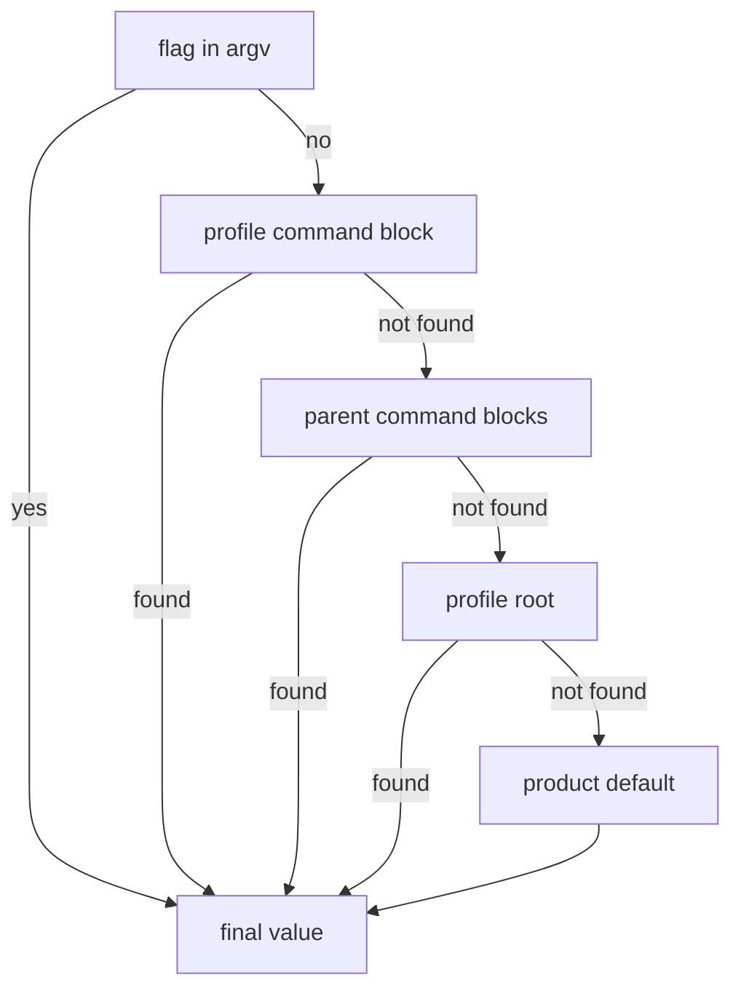

# Профили и выбор значений параметров

**Профиль** — YAML-файл с настройками запуска Git Herder. Здесь зафиксированы:  
формат файла, какой профиль подхватывается при запуске и **в каком порядке** берётся
итоговое значение каждого параметра: сначала командная строка, затем профиль, затем
встроенные значения продукта.

Смысл глобальных флагов — в [глобальных параметрах CLI](../cli/index.md). Замысел
уровня продукта — [профили Git Herder](../../product-intent/capability/platform/profiles.md).

## Трассировка вверх

- [Capability профилей](../../product-intent/capability/platform/profiles.md)
- [Глобальные параметры CLI](../cli/index.md)
- [Структурированное логирование](logging.md) — скрытие `token` и других секретов из профиля в журнале

## Назначение

Профиль избавляет от повторного ввода данных для [SCM](../../../glossary/terms/scm-platform.md) и типовых
настроек массовых операций. За один запуск `githerd` используется **не больше одного**
профиля.

Переменные окружения **никогда** не подставляются в значения параметров.

## Каталог и файлы

| Что | Путь | Зачем |
| --- | ---- | ----- |
| Каталог профилей | `~/.config/git-herder/` | Все профили на этой машине |
| Профиль | `~/.config/git-herder/<имя>.yaml` | Именованный набор настроек |
| Профиль по умолчанию | `~/.config/git-herder/default` | Файл **без расширения**: одна строка — имя профиля (пробелы по краям отбрасываются) |

### Какой профиль читается при запуске

| Ситуация | Что загружается |
| -------- | --------------- |
| В командной строке есть `--profile <имя>` | `<имя>.yaml`; файл `default` **не** смотрим |
| `--profile` нет, есть файл `default` | `<имя из default>.yaml` |
| Нет ни `--profile`, ни файла `default` | Профиль **не** используется (остаются только CLI и встроенные значения продукта) |

Если имя профиля задано (через `--profile` или `default`), а файла `<имя>.yaml` **нет**
— **ошибка настроек**, код выхода `1` (см. [cli/index.md](../cli/index.md)), **кроме**
дерева команды [`profile`](../cli/profile/index.md): там см. [исключение](#битый-указатель-default).

Команда `profile` и её подкоманды **не** загружают профиль для резолва глобальных флагов
этого же запуска. Глобальный флаг `--profile` в этом дереве **запрещён** (ошибка
настроек, exit `1`) — см. [команду `profile`](../cli/profile/index.md).

Описание флага `--profile` — в [глобальных параметрах CLI](../cli/index.md).

## Структура YAML

Корень файла — объект (пары «ключ — значение»).

- Блок `root` — общие настройки (как глобальные флаги CLI).
- Ключи верхнего уровня с **именами команд** (`clone`, `publish`, …) — настройки для
этой команды (имя совпадает с `Command.Name()` в Cobra).
- Внутри блока команды — плоский список параметров `ключ: значение`.
- **Подкоманды** — вложенные блоки под родительской командой; правила те же.

Имена ключей — как длинные флаги **без** `--`: `retries-number`, `on-error`, `workspace`,
`upstream-group` и т.д.

### Пример

```yaml
root:
  upstream: github
  host: github.com
  token: "<pat>"
  retries-number: 7
  workspace: ~/code/fy/pool/day
  on-error: abort
clone:
  on-error: continue
publish:
  workspace: ~/code/fy/pool/day/qwer/rtyu/iop
  upstream-group: qwer/rtyu/iop
```

Что означают ключи, которых нет в [таблице глобальных флагов](../cli/index.md)
(например `upstream-group`), — в спеках **конкретных** команд.

## Какие ключи можно писать в YAML

| Ключ или правило                                           | Что делает продукт                                                                        |
| ---------------------------------------------------------- | ----------------------------------------------------------------------------------------- |
| `verbose`, `help`, `version`, `profile` на любом уровне    | **Пропускает** (на итоговые значения не влияет)                                           |
| `debug`                                                    | Можно в `root` и в блоках команд; участвует в [выборе значения](#порядок-выбора-значения) |
| `upstream`, `host`, `token`                                | Только в блоке `root`                                                                     |
| `upstream`, `host`, `token` в блоке команды или подкоманды | **Ошибка настроек**, код `1`                                                              |
| Неизвестный ключ                                           | **Пропускает** (не ошибка)                                                                |

## Порядок выбора значения

Для каждого параметра, который нужен текущей команде:

1. **Командная строка** — если пользователь **явно передал** флаг (в том числе

   `--flag=false` для логических флагов; в коде — аналог «флаг изменён» в pflag).
2. Иначе значение в блоке **текущей** подкоманды в загруженном профиле (если профиль

   есть и ключ задан).
3. Иначе то же поле в **родительских** блоках команд вверх по дереву Cobra.
4. Иначе блок `root` профиля.
5. Иначе **встроенное значение по умолчанию** из [глобальных параметров CLI](../cli/index.md)

   (колонка «По умолчанию»; для `host` — [таблица от](../cli/index.md#подключение-к-scm) `upstream`
    после того, как уже известен `upstream`).



### Связанные значения по умолчанию

Сначала определяют `upstream`. Если после шагов 1–5 `host` всё ещё пустой — подставляют
встроенный `host` по правилам [подключения к SCM](../cli/index.md#подключение-к-scm).

### Пути

Для полей с путями (`workspace` и др.): после выбора значения раскрывают `~` в домашний
каталог; относительный путь считают от текущего каталога на момент старта команды;
затем приводят к абсолютному — как для [`--workspace`](../cli/index.md#workspace).

## Ошибки настроек

До выполнения команды, код выхода `1` (если иное не сказано ниже):

- в `default` указано имя, для которого нет `<имя>.yaml` — для **всех команд, кроме**
  дерева [`profile`](../cli/profile/index.md);
- `--profile` указывает на несуществующий `<имя>.yaml`;
- `upstream`, `host` или `token` записаны не в `root`;
- синтаксическая ошибка в YAML загружаемого профиля — по общим правилам продукта.

### Битый указатель `default`

Файл `default` существует, в нём после trim непустое имя, а `<имя>.yaml` **отсутствует**.

| Контекст | Поведение |
| -------- | --------- |
| Любая команда, **кроме** `profile` и её подкоманд | Ошибка настроек, exit `1`; профиль для резолва **не** подставляется |
| `githerd profile` и все подкоманды `profile` | **Не** ошибка настроек; запись `level=warn` в журнал и то же предупреждение на консоль (pterm); команда продолжается |

Управление профилями и детали предупреждения — [спека команды `profile`](../cli/profile/index.md).

## Инварианты

- На один запуск — один профиль или ни одного.
- Значения параметров из переменных окружения **не** читаются.
- `verbose`, `help`, `version` в YAML не меняют поведение.
- Секреты из профиля маскируются в журнале — [logging.md](logging.md).

## Не описывать здесь

- CLI управления профилями (`list`, `use`, `create`, `drop`, `edit`) — [команда `profile`](../cli/profile/index.md).
- Проверка профиля на SCM (отдельная команда, когда появится).
- Смысл параметров отдельных команд (`upstream-group`, отбор и т.п.).
- Код в `application/` (в том числе Viper).
