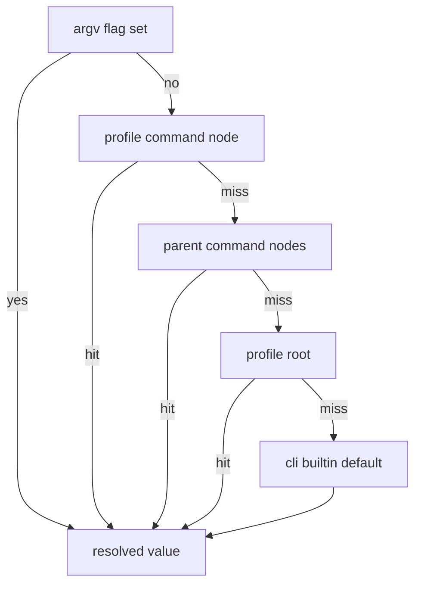

# Профили и резолв конфигурации

Именованные **профили** — YAML-файлы с дефолтами параметров Git Herder. Механизм
задаёт формат профиля, выбор активного профиля на запуск и **единый порядок резолва**
значений: CLI → узлы профиля → встроенные значения по умолчанию продукта.

Глобальные флаги и их семантика — [глобальные параметры CLI](../cli/index.md). Замысел
capability — [профили Git Herder][profiles-capability].

## Трассировка вверх

- [Capability профилей][profiles-capability]
- [Глобальные параметры CLI](../cli/index.md)
- [Структурированное логирование](logging.md) — маскировка `token` и секретов из профиля

## Назначение

Профиль снимает повторный ввод подключения к [SCM][SCM-PLATFORM-TERM] и типовых
параметров массовых операций. На один запуск процесса применяется **не более одного**
загруженного профиля.

Переменные окружения **не** участвуют в резолве параметров **никогда**.

## Каталог и файлы

| Объект | Путь | Назначение |
| ------ | ---- | ---------- |
| Каталог профилей | `~/.config/git-herder/` | Все профили пользователя на машине |
| Данные профиля | `~/.config/git-herder/<имя>.yaml` | Именованный профиль |
| Указатель по умолчанию | `~/.config/git-herder/default` | Файл **без расширения**; одна строка — имя профиля (`trim`) |

### Выбор профиля на запуск

| Условие | Какой профиль загружается |
| ------- | ------------------------- |
| В argv задан `--profile <имя>` | `<имя>.yaml`; содержимое файла `default` **не** читается |
| `--profile` нет, есть файл `default` | `<имя из default>.yaml` |
| `--profile` нет, файла `default` нет | Профиль **не** применяется (резолв только CLI + builtin) |

Если указан или выбран через `default` профиль, но файл `<имя>.yaml` **отсутствует**
— **ошибка конфигурации**, код выхода `1` (см. [cli/index.md](../cli/index.md)).

Флаг `--profile` описан в [глобальных параметрах CLI](../cli/index.md).

## Структура YAML

Корень документа — mapping.

- Узел **`root`** — глобальные параметры (аналог глобальных флагов CLI).
- Узлы верхнего уровня с **именами команд** (`clone`, `publish`, …) — дефолты для
  соответствующей команды Cobra (`Command.Name()` на каждом уровне дерева).
- Внутри узла команды — плоские пары `ключ: значение`.
- **Субкоманды** — вложенные mapping под родительской командой; те же правила, что
  для родителя.

Имена ключей — как длинные имена флагов **без** `--` (`retries-number`, `on-error`,
`workspace`, `upstream-group`, …).

### Пример

```yaml
root:
  upstream: github
  host: github.com
  token: "<pat>"
  retries-number: 7
  workspace: ~/code/fy/pool/day
  on-error: abort
clone:
  on-error: continue
publish:
  workspace: ~/code/fy/pool/day/qwer/rtyu/iop
  upstream-group: qwer/rtyu/iop
```

Семантика ключей, не входящих в [глобальную таблицу флагов](../cli/index.md)
(`upstream-group` и т.п.), — в спеках **конкретных** команд.

## Допустимые и запрещённые ключи

| Ключ / правило | Поведение |
| -------------- | --------- |
| `verbose`, `help`, `version` на любом уровне | **Игнорировать** (на резолв не влияют) |
| `debug` | Разрешён в `root` и в узлах команд; участвует в [резолве](#порядок-резолва) |
| `upstream`, `host`, `token` | Только в узле **`root`** |
| `upstream`, `host`, `token` в узле команды или субкоманды | **Ошибка конфигурации**, код `1` |
| Неизвестный ключ (нет в cli и не описан в спеке команды) | **Игнорировать** |

## Порядок резолва

Для каждого параметра, который команда использует на текущем уровне дерева CLI:

1. **CLI** — если флаг **задан** в argv (эквивалент `Changed` в pflag: пользователь
   явно передал флаг, в том числе `--flag=false` для boolean).
2. Иначе значение в узле **текущей** субкоманды загруженного профиля (если профиль
   применён и ключ присутствует).
3. Иначе обход **родительских** узлов команд в профиле вверх по цепочке Cobra.
4. Иначе узел **`root`** профиля.
5. Иначе **builtin default** из [глобальных параметров CLI](../cli/index.md) (колонка
   «По умолчанию»; для `host` — [таблица по `upstream`](../cli/index.md#подключение-к-scm) после
   резолва `upstream`).



### Зависимые встроенные значения

Сначала резолвят `upstream`. Если после шагов 1–5 `host` всё ещё не задан — builtin
`host` по правилам [подключения к SCM](../cli/index.md#подключение-к-scm).

### Пути

Для ключей с путями (`workspace` и др.): после резолва раскрывают `~` в домашний
каталог пользователя; относительные пути интерпретируют от CWD на момент старта
команды; затем приводят к абсолютному — как для [`--workspace`](../cli/index.md#workspace).

## Ошибки конфигурации

До выполнения логики команды, код выхода **`1`**:

- файл `default` указывает на профиль, для которого нет `<имя>.yaml`;
- `--profile` ссылается на отсутствующий `<имя>.yaml`;
- `upstream`, `host` или `token` заданы не в `root`;
- иные фатальные ошибки разбора YAML (синтаксис) — по правилам продукта.

## Инварианты

- На один запуск — один загруженный профиль (или ни одного).
- Резолв **не** читает переменные окружения для значений параметров.
- `verbose`, `help`, `version` в YAML не влияют на поведение.
- Секреты из профиля подпадают под [маскировку в журнале](logging.md).

## Не описывать здесь

- Команды управления профилями (создание, удаление, проверка на SCM).
- Семантика параметров отдельных команд (`upstream-group`, отбор, …).
- Реализация в `application/` (в том числе Viper).

<!-- LINKS -->
[profiles-capability]: ../../product-intent/capability/platform/profiles.md
[SCM-PLATFORM-TERM]: ../../../glossary/terms/scm-platform.md
