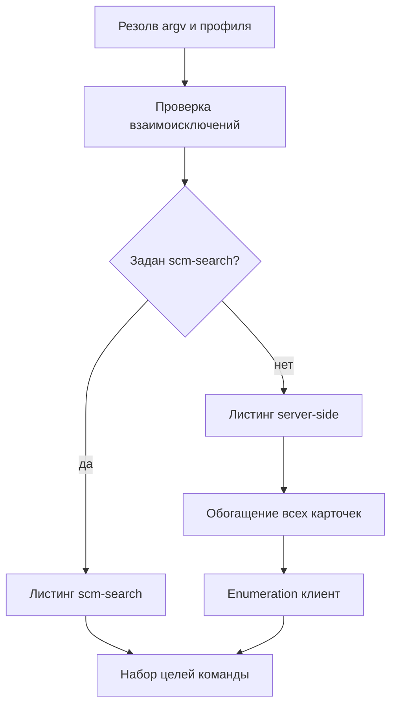

# SCM-отбор репозиториев

Единый контракт **критериев SCM-отбора** для массовых команд, обращающихся к
[SCM API][SCM-PLATFORM-TERM]: отчёты, клонирование с платформы, правки метаданных и
другие операции с одним и тем же смыслом «какой набор репозиториев затронуть».

**Локальный отбор** рабочих копий на диске здесь **не** описан — см.
[единый отбор (capability)][repository-selection-capability] (подмодель локального
отбора). Глобальный `--workspace` — [глобальные параметры CLI](../cli/index.md).

Замысел отбора: [repository-selection (capability)][repository-selection-capability].
Перечисление и локальная оценка части критериев: [ADR-26102001][adr-local-eval].
Guard на публичных SaaS: [ADR-26102002][adr-saas-guard]. Раскладка hub и
extension для SCM-специфичных ключей: [ADR-26102201][adr-hub-extension]. Контекст SCM
(`--upstream`, `--host`, `--token`) и резолв конфигурации —
[cli/index.md](../cli/index.md), [profiles.md](profiles.md).

## Трассировка вверх

- [Единый отбор для массовых операций][repository-selection-capability]
- [ADR-26102001: локальная оценка критериев SCM-отбора][adr-local-eval]
- [ADR-26102002: guard affiliation-scope на публичных SaaS][adr-saas-guard]
- [ADR-26102201: hub и extension-спеки SCM-отбора][adr-hub-extension]
- [Глобальные параметры CLI](../cli/index.md) (подключение к SCM, коды выхода)
- [Профили и выбор значений](profiles.md)

## Назначение

Пользователь задаёт критерии в терминах Git Herder; команда получает **итоговый
набор** репозиториев на выбранной [SCM-платформе][SCM-PLATFORM-TERM]. **Переносимые**
опции отбора (таблица ниже), общий резолв с профилем и композиция критериев
зафиксированы в **этом** документе (hub). **SCM-специфичные** флаги и ключи профиля (extension) —
в [options per upstream](#options-per-upstream); листинг и обогащение hub- и
extension-параметров на API — `repository-listing/`, `repository-enrichment/`
([ADR-26102201][adr-hub-extension], оркестрация — [scm/index.md](../scm/index.md));
спеки команд таблицы **не** дублируют.

## Синтаксис CLI

Критерии — **опции команды** (не глобальные флаги корня `githerd`), если иное не
сказано в спеке конкретной команды. Правила разбора argv — [синтаксис опций](../cli/index.md#синтаксис-опций).

| Правило | Текст |
| ------- | ----- |
| Повтор флага | Каждое повторение `--qp`, `--qn`, `--qt`, `--qa` добавляет **отдельное** условие; все условия после резолва объединяются по **AND** (см. [композицию критериев](#композиция-критериев)). |
| `--scm-search` | Ровно **одно** задание поиска в argv (один флаг); повтор флага — ошибка контракта (exit `1`). Синтаксис и разбор — `scm/<upstream>/repository-listing/scm-search.md`. |
| `--scope` | Одно значение: `affiliated` или `all` (канон — нижний регистр); явное `--scope=…` в argv считается заданным значением. |
| Разделитель `--` | Как в [cli/index.md](../cli/index.md#синтаксис-опций). |
| Взаимоисключение | После резолва нельзя одновременно иметь `--scm-search` и **любой** из `--qp`, `--qn`, `--qt`, `--qa` — [ошибка до старта](#ошибки-и-коды-выхода). |

## Таблица опций

| Имя | Тип | По умолчанию | Назначение |
| --- | --- | ------------ | ---------- |
| `--qp` | повторяемая строка | не задан | Отбор по **пути** репозитория на платформе (owner, group, namespace — смысл поля зависит от SCM, не от команды). |
| `--qn` | повторяемая строка | не задан | Отбор по **имени** репозитория (без полного пути). |
| `--qt` | повторяемая строка | не задан | Отбор по **тегам**: строгое **наличие** или **отсутствие** (см. [ниже](#qt-теги-qt-теги)). |
| `--qa` | повторяемая строка | не задан | Отбор по **пользовательским атрибутам** (custom properties и аналоги): сравнение `key` и `value` (см. [ниже](#qa-атрибуты)). |
| `--scm-search` | per upstream (см. listing) | не задан | Поиск **средствами SCM**; формат argv и HTTP — [listing `scm-search`](#options-per-upstream) выбранного `upstream`. |
| `--scope` | `affiliated` \| `all` | `affiliated` | Контур перечисления: **связанные с пользователем** или **без** этого ограничения (см. [scope](#scope)). |

Ключи в YAML-профиле — те же имена **без** `--`: `qp`, `qn`, `qt`, `qa`,
`scm-search`, `scope`.

## Options per upstream

Extension-флаги (только для одного `upstream` после резолва): контракт CLI и
продуктовый эффект **без** REST — [ADR-26102201][adr-hub-extension].

| `upstream` | Options | Base list / карточка | Listing | Enrichment | Enumeration (клиент) |
| ---------- | ------- | -------------------- | ------- | ---------- | ---------------------- |
| `github` | [options](../scm/github/repository-selection-options.md) | [base-enumeration](../scm/github/base-enumeration.md) (+ [карточка][scm-repository-card]) | [listing/index](../scm/github/repository-listing/index.md) | [enrichment/index](../scm/github/repository-enrichment/index.md) | [enumeration/index](../scm/github/repository-enumeration/index.md) |
| `gitlab` | [options](../scm/gitlab/repository-selection-options.md) | [base-enumeration](../scm/gitlab/base-enumeration.md) (+ [карточка][scm-repository-card]) | [listing/index](../scm/gitlab/repository-listing/index.md) | [enrichment/index](../scm/gitlab/repository-enrichment/index.md) | [enumeration/index](../scm/gitlab/repository-enumeration/index.md) |

Порядок фаз listing → enrichment → enumeration — [scm/index.md](../scm/index.md).
**Listing** — server-side list; **enrichment** — дозагрузки полей карточки;
**enumeration** — клиентская фильтрация (`qp`, `qn`, `qt`, `qa`);
[ADR-26102201][adr-hub-extension].

Общие правила для extension (детали флагов — только в options; list —
`repository-listing/<parameter>.md`; обогащение — `repository-enrichment/`; клиент —
`repository-enumeration/<parameter>.md`):

| Правило | Текст |
| ------- | ----- |
| Резолв с профилем | Как для переносимых ключей — [ниже](#резолв-с-профилем) и [profiles.md](profiles.md); алгоритм в options **не** повторять. |
| Допустимость | Флаг или ключ профиля из options **чужого** `upstream` — ошибка до старта (exit `1`). |
| Композиция | Условия extension и переносимые `--q*` после резолва — **AND**, если в options не сказано иное. |
| Критерий задан | Extension-параметр, описанный как **критерий** в options, учитывается при проверке «задан хотя бы один критерий» ([ошибки](#ошибки-и-коды-выхода)). **Модификаторы** pipeline (например `include-inactive` на GitLab) критерием **не** считаются — только в options. |
| `scm-search` | Взаимоисключения extension с `--scm-search` — в options или listing; модификаторы hub/extension в ветке `--scm-search` **не** применяются, если не сказано иное. |
| Таблицы options | В hub **не** дублировать (например `--include-inactive` — только GitLab options). |

## Резолв с профилем

Общий порядок выбора значения — [profiles.md](profiles.md#порядок-выбора-значения).
Ключи отбора допустимы в блоке `root` и в блоке **любой** команды или подкоманды.

### Один ключ — одно происхождение

Для каждого ключа из таблицы выше (`qp`, `qn`, `qt`, `qa`, `scm-search`,
`scope`) итоговое значение после резолва берётся так:

| Ситуация | Итог |
| -------- | ---- |
| Параметр **явно задан в argv** (включая повторы флага для `qp`…`qa` или `--scope=…`) | **Только argv**; значение этого ключа из профиля **не** подмешивается. |
| Параметр в argv **не** задан | Значение из профиля по цепочке leaf → parents → `root`; если ключа нет — встроенное по умолчанию из таблицы (для `scope` — `affiliated`, для остальных — «не задан»). |

Смешивать список из профиля и повторы того же ключа в argv **нельзя**.

### Несколько значений в профиле

| Форма YAML | Смысл |
| ---------- | ----- |
| `qp: значение` | Одно условие `--qp`. |
| `qp: [a, b]` | Два условия, как `--qp a --qp b` после резолва (если `qp` не переопределён в argv). |

То же для `qn`, `qt`, `qa`.

### Пример

```yaml
root:
  upstream: gitlab
  host: gitlab.com
  token: "<pat>"
  scope: affiliated
  qp: my-group/
clone:
  qn: [service-, api-]
  qt: [foo, bar=null]
```

При `githerd clone --qn billing` в argv ключ `qn` целиком из argv (`billing` одно
условие); `qp` и `qt` — из профиля блока `clone` и `root` по правилам
[profiles.md](profiles.md).

## Композиция критериев

После резолва все условия из `--qp`, `--qn`, `--qt`, `--qa` объединяются логическим
**И** (AND): репозиторий попадает в набор только если удовлетворяет **каждому**
условию.

### `qp` и `qn`

Для **каждого** значения `--qp` или `--qn`:

1. Продукт **пытается** скомпилировать строку как **регулярное выражение** (синтаксис
   движка регэкп в реализации, re2-совместимый).
2. Если компиляция **успешна** — сопоставление по регэкп с полем **путь** (`qp`) или
   **имя** (`qn`).
3. Если компиляция **неуспешна** — сопоставление по **вхождению подстроки** в путь
   или имя соответственно.

Несколько значений одного флага — несколько условий, связанных AND с остальными.

Оценка `qp` / `qn` выполняется **локально** по карточке после перечисления
([ADR-26102001][adr-local-eval]); per-SCM алгоритм — `scm/<upstream>/repository-enumeration/qp.md`
и `qn.md`.

#### GitHub (`upstream=github`)

Критерии `--qp` и `--qn` **не** оцениваются регэкпом/подстрокой на карточке: отбор
только через query `q` базового `GET /search/repositories`
([github/repository-listing/index.md § сборка q][github-listing-q-build]).
Файлов `qp`/`qn` в [repository-enumeration/][github-enumeration-index] **нет** (только
server-side). Значения `--qp`/`--qn` для Search — литералы из ограниченного алфавита
([github base-enumeration § ограничения API][github-base-limits]).

### `qt` (теги) {#qt-теги}

`--qt` задаёт условия только по **тегам** (признак «есть такой тег» / «нет такого
тега»). Key-value атрибуты — [`--qa`](#qa-атрибуты), не `--qt`.

Допустимы **два** вида условия (после разбора значения):

| Вид | CLI | Продуктовый смысл |
| --- | --- | ----------------- |
| Строгое **наличие** | `--qt` *имя* (аргумент **без** символа `=`) | У репозитория **есть** тег *имя*. |
| Строгое **отсутствие** | `--qt` *имя*`=null` | У репозитория **нет** тега *имя*. |

Примеры:

```text
--qt foo --qt bar
--qt foo=null --qt bar=null
```

⇔ (есть `foo`) **AND** (есть `bar`); второй пример ⇔ (нет `foo`) **AND** (нет `bar`).

Несколько `--qt` после резолва связываются **AND**, как остальные `--q*`.

#### Разбор значения `--qt`

Для **каждого** значения после резолва (argv или профиль):

1. Если аргумент оканчивается на `=` + `null` (**без учёта регистра** `null`) → режим
   **отсутствие**; *имя тега* — префикс строки **до** этого суффикса (суффикс ровно
   `=` + `null`, case-insensitive; имя может содержать `=`).
2. Иначе, если в аргументе есть **`=`** → **ошибка разбора** (exit `1`).
3. Иначе → режим **наличие**; *имя тега* — весь аргумент.

После разбора *имя тега* **не** должно быть пустым; иначе — **ошибка разбора** (exit `1`).

Любое значение вида `--qt name=…`, где часть после первого `=` **не** является
единственным маркером отсутствия `null` (case-insensitive) в форме суффикса `=null`, —
**ошибка разбора** (exit `1`). Пример ошибки: `--qt team=Alpha`.

Проверка `<`, `>`, `<=`, `>=` в `--qt` — **ошибка разбора** (exit `1`).

Сопоставление с данными репозитория — [scm-repository-card.md](scm-repository-card.md)
(поле `labels`); per-SCM листинг — `scm/<upstream>/repository-listing/qt.md`,
обогащение — `scm/<upstream>/repository-enrichment/` (если есть), фильтрация —
`scm/<upstream>/repository-enumeration/qt.md`.

### `qa` (атрибуты)

Значение — `key` + оператор + `value`. Операторы: `=`, `!=`, `<`, `>`, `<=`, `>=`.

| Оператор | Смысл |
| -------- | ----- |
| `=`, `<`, `>`, `<=`, `>=` | Ключ **присутствует**; сравнение значения с `value` по правилам строки ниже. |
| `!=` | Ключ **обязан** существовать в `properties`; значение **не равно** `value`. |

Для `<`, `>`, `<=`, `>=` в P0 сравнение **лексикографическое** по строковому
представлению значения на стороне Git Herder (без отдельной типизации per SCM).

Символы `<` и `>` в shell передают через `--qa=key>=value`, кавычки или аргументы
после `--` — [синтаксис опций](../cli/index.md#синтаксис-опций).

Несколько `--qa` — AND. Листинг и обогащение — `repository-listing/qa.md` и
`repository-enrichment/qa.md`; проверка на карточке — `repository-enumeration/qa.md`
per `upstream`.

#### Разбор значения `--qa`

Для **каждого** значения после резолва (argv или профиль):

1. Найти **оператор** — первое вхождение в строке аргумента в порядке проверки:
   `<=`, `>=`, `!=`, `<`, `>`, `=` (чтобы не принять `=` внутри `!=`, `<=`, `>=`).
2. *key* — префикс строки **до** найденного оператора; *value* — суффикс **после**
   оператора (может содержать `=`, `<`, `>` и т.д.).
3. Если оператор **не** найден → **ошибка разбора** (exit `1`).
4. Если *key* пустой → **ошибка разбора** (exit `1`).
5. Пустой *value* **допустим** (сравнение с пустой строкой / канонической строкой
   scalar по [карточке][scm-repository-card]).

Per-SCM server-side list — `scm/<upstream>/repository-listing/qa.md`; обогащение
`properties` — `repository-enrichment/qa.md`; клиентская проверка —
`repository-enumeration/qa.md`.

### `scm-search`

- Переносимый критерий **один**; повтор `--scm-search` в argv — [ошибка](#ошибки-и-коды-выхода).
- **Синтаксис argv, разбор и ограничения значения** задаёт только
  `scm/<upstream>/repository-listing/scm-search.md` (у каждого upstream
  свой контракт; hub глобальный формат **не** фиксирует).
- Режим **не** использует критерии `--q*` и **не** применяет продуктовый
  [scope](#scope) к запросу в SCM (штатная ситуация).
- Результат отбора — множество репозиториев, возвращённое SCM по этому запросу
  (нормализация в карточку — listing / base-enumeration per `upstream`).

### `scope`

Допустимые значения после резолва: только **`affiliated`** и **`all`** (нижний
регистр). Любое другое — [ошибка до старта](#ошибки-и-коды-выхода).

Один только `--scope` (в том числе значение по умолчанию `affiliated`) **не**
считается заданным **критерием** отбора.

| Значение | Поведение (режим `--q*`, не `--scm-search`) |
| -------- | --------------------------------------------- |
| `affiliated` (по умолчанию) | Адаптер **добавляет** к запросам листинга и обогащения (до локальной фильтрации `--q*`) продуктовое ограничение: только репозитории, **связанные с текущим пользователем**. Листинг на HTTP — [listing `scope`](#options-per-upstream) выбранного `upstream`. |
| `all` | Это ограничение **не** добавляется. |

В режиме `--scm-search` значение `--scope` **не влияет** на запрос в SCM; правила
публичного SaaS для `scope` и предупреждения — [ADR-26102002][adr-saas-guard-scope]
(в ветке `--scm-search` предупреждение **не** выводится).

Листинг `affiliated` / `all` на HTTP — в `repository-listing/scope.md`;
политика на `github.com` / `gitlab.com` — **только** в [ADR-26102002][adr-saas-guard-scope]:

| `upstream` | Listing `scope` |
| ---------- | ----------------- |
| `github` | [github/repository-listing/scope.md](../scm/github/repository-listing/scope.md) |
| `gitlab` | [gitlab/repository-listing/scope.md](../scm/gitlab/repository-listing/scope.md) |

## Пайплайн отбора

Детали очереди и прогресса — [scm/index.md § алгоритм](../scm/index.md#алгоритм-q-star).



1. Резолв параметров отбора и SCM-контекста.
2. Проверка: задан хотя бы один критерий; нет конфликта `scm-search` + `--q*`.
3. Ветка **`--scm-search`** — один листинг в адаптере; иначе **сначала** листинг с
   учётом `--scope` и extension-модификаторов, **затем** обогащение **всех** карточек,
   **затем** клиентская фильтрация `qp`, `qn`, `qt`, `qa` ([ADR-26102001][adr-local-eval]).
   На GitHub `--qp`/`--qn` участвуют в **листинге** (Search `q`), а не в локальной оценке
   hub выше.

## Ошибки и коды выхода

До выполнения тела команды, если не сказано иное, код выхода **`1`** (как ошибка
настроек в [cli/index.md](../cli/index.md)):

| Условие | Действие |
| ------- | -------- |
| После резолва одновременно `--scm-search` и любой `--q*` | Сообщение об ошибке; команда не стартует. |
| Повтор `--scm-search` в argv | Ошибка контракта. |
| Неверный синтаксис `--scm-search` для текущего `upstream` (по listing) | Ошибка разбора значения, exit `1`. |
| Ни один критерий не задан (переносимые `qp`, `qn`, `qt`, `qa`, `scm-search` и задействованные extension-параметры для текущего `upstream` все «не задан») | Ошибка: не задан критерий SCM-отбора. **Исключение:** команда [`report`](../cli/report/index.md#поток-выполнения) — предупреждение и подтверждение до SCM, не этот exit. |
| После резолва задан extension-параметр не для текущего `upstream` | Ошибка до старта (exit `1`). |
| Неверный синтаксис значения `--qt` (в т.ч. операторы `<` … `>=`) | Ошибка разбора значения. |
| Неверный синтаксис значения `--qa` | Ошибка разбора значения. |
| `--scope` не `affiliated` и не `all` | Ошибка контракта. |
| `upstream=github`, режим `--q*`, после резолва **нет** server-side фрагмента для `q` (только `--qt`, или только `--qa` без `=`, и т.п.) | Ошибка до HTTP: нужен `--qp`, `--qn` или `--qa` с `=` ([github listing § сборка q][github-listing-q-build]). |
| `upstream=github`, неверный алфавит значения `--qp` или `--qn` | Ошибка до HTTP, exit `1` ([github base-enumeration § ограничения API][github-base-limits]). |

Итоговый набор **пуст** после успешного отбора — поведение **команды** (ошибка,
предупреждение или успех с нулём объектов); здесь не фиксируется.

Переносимый флаг без аналога на выбранной SCM (не extension) — по-прежнему открытый
вопрос в [capability отбора][repository-selection-capability]; для **extension**-флагов
чужого `upstream` действует [ошибка](#ошибки-и-коды-выхода) выше.

## Инварианты

- Таблица **переносимых** опций SCM-отбора живёт **только** в этом файле (hub).
- Таблица опций **extension** для каждого `upstream` — **только** в
  `scm/<upstream>/repository-selection-options.md`; листинг и обогащение — в
  `scm/<upstream>/repository-listing/` и `repository-enrichment/` ([раскладка][adr-hub-extension]).
- Режим `--scm-search` несовместим с любым `--q*` после резолва.
- В режиме `--scm-search` продуктовый `scope` к запросу в SCM **не** применяется.
- `scope`: только `affiliated` или `all`; default `affiliated`; один только `scope` не
  критерий отбора.
- Все условия `--q*` после резолва связаны **AND**.
- `qp` / `qn`: регэкп при успешной компиляции, иначе подстрока (кроме GitHub — Search
  `q`, см. [§ qp и qn — GitHub](#qp-и-qn)).
- `qt`: только **наличие** (аргумент без `=`) или **отсутствие** (суффикс `=null`,
  `null` без учёта регистра); иное `=` в значении — ошибка разбора; пустое имя тега —
  ошибка разбора.
- `qa`: разбор оператора в порядке `<=`, `>=`, `!=`, `<`, `>`, `=`; пустой *key* —
  ошибка разбора; для `!=` ключ обязан существовать в `properties`; порядковые операторы —
  лексикографическое сравнение канонических строк ([карточка][scm-repository-card]).
- Профиль и argv для одного ключа **не смешиваются**.

## Не описывать здесь

- Таблицы SCM-специфичных extension-флагов — [options per upstream](#options-per-upstream).
- Листинг и обогащение — `scm/<upstream>/repository-listing/`,
  `repository-enrichment/`; оркестрация — [scm/index.md](../scm/index.md).
- Базовый list, пагинация — `scm/<upstream>/base-enumeration.md`.
- Cross-SCM **имена и типы** полей карточки — [scm-repository-card.md](scm-repository-card.md); наполнение из API — `scm/<upstream>/base-enumeration.md`.
- Клиентская фильтрация `--q*` — `scm/<upstream>/repository-enumeration/<parameter>.md`.
- Per-SCM наполнение карточки из list — только в `base-enumeration.md`, не здесь.
- Пошаговые сценарии отдельных команд — `cli/<command>/`.
- Реализацию в `application/`.
- Локальный отбор рабочих копий.

<!-- LINKS -->
[SCM-PLATFORM-TERM]: ../../../glossary/terms/scm-platform.md
[repository-selection-capability]: ../../product-intent/capability/platform/repository-selection.md
[adr-local-eval]: ../../../ADR/ADR-26102001-scm-repository-selection-evaluation.md
[adr-saas-guard]: ../../../ADR/ADR-26102002-public-saas-scm-affiliation-guard.md
[adr-saas-guard-scope]: ../../../ADR/ADR-26102002-public-saas-scm-affiliation-guard.md#scope-public-saas
[adr-hub-extension]: ../../../ADR/ADR-26102201-scm-selection-hub-extension-specs.md
[scm-repository-card]: scm-repository-card.md
[github-listing-q-build]: ../scm/github/repository-listing/index.md#сборка-q
[github-enumeration-index]: ../scm/github/repository-enumeration/index.md
[github-base-limits]: ../scm/github/base-enumeration.md#ограничения-api
